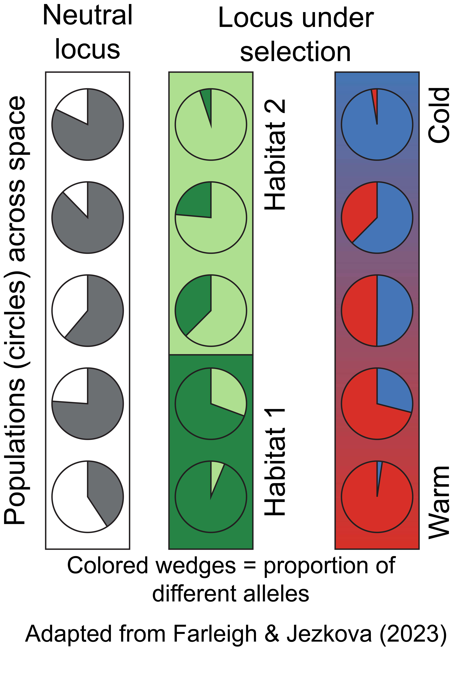
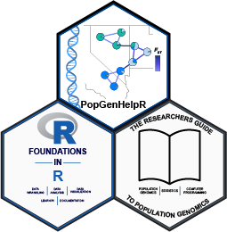

I seek to understand how biodiversity arises and persists by investigating the evolutionary processes that influence divergence during speciation and in response to environmental variation. I integrate techniques from many fields including but not limited to, ecology, biogeography, population genomics, transcriptomics, and bioinformatics. My research is broadly organized around two themes (see below).

1\. __*Investigating the genomic basis of divergence with particular focus on the evolution of reproductive isolation and responses to environmental variation.*__

A central goal of my research program is to determine how reproductive isolation evolves across the speciation continuum. Theory predicts that reproductive isolation will evolve in different stages during speciation with gene flow. Initially, reproductive isolation will be largely influenced by a few divergent traits, before genes underlying these traits become associated (coupled) which strengthens the total amount of reproductive isolation between lineages (relative to their individual affects). While this theory has existed for some time, few studies have been able to test it. In [Farleigh et al. (2026)](https://www.pnas.org/doi/abs/10.1073/pnas.2609058123) we found evidence of these transitions in the evolution of reproductive isolation and provided an empirical framework to test these theoretical predictions. I am currently working on a project where I explore the initial stages of speciation and ask what forms of selection are acting to promote divergence and how the influences of different forms of selection change across the speciation continuum.

Another goal of my research program is to determine how environmental variation shapes genomic divergence and drives the evolution of reproductive isolation. Environmental variation promotes divergence through divergent selection (ecological speciation) or through different responses to similar selective pressures (mutation-order speciation). Yet, our understanding of these processes is incomplete and studies that investigate how environmental variation with genomic divergence is paramount. Moreover, studies investigating this topic can provide vital information regarding how species respond to environmental changes and if those responses influence species' ability to persist. I have led and participated in various studies that link environmental variation to genomic variation and found divergence due to climate ([Bist et al., 2026](https://academic.oup.com/jmammal/article/107/3/546/8684158); [Brunton et al., 2024](https://link.springer.com/article/10.1007/s10980-024-01828-w); [Farleigh et al., 2021](https://onlinelibrary.wiley.com/doi/full/10.1111/mec.16070); [Finger et al., 2022](https://academic.oup.com/gbe/article/14/1/evab260/6443127); [Pavon-Vasquez et al., 2024](https://academic.oup.com/sysbio/article/73/2/323/7512966)), ecology ([Farleigh et al. (2026)](https://www.pnas.org/doi/abs/10.1073/pnas.2609058123)), and vegetation ([Farleigh & Jezkova, 2023](https://link.springer.com/article/10.1007/s10980-023-01774-z)). 

2\. __*Developing open source bioinformatic software that enables robust and reproducible analyses.*__

Advances in sequencing technologies have transformed evolutionary biology from analyses of a handful of genetic markers to genome-scale datasets containing millions of variants. This transformation has created a growing need for accessible computational tools and training that allow researchers to perform accurate and reproducible analyses of increasingly complex genomic datasets. To address this need, I developed [PopGenHelpR](https://kfarleigh.github.io/PopGenHelpR/), which streamlines population genomic analysis and provides tutorials and documentation that enable users with no prior experience to understand and perform analyses ([Farleigh et al., 2026](https://onlinelibrary.wiley.com/doi/10.1111/1755-0998.70142)). I am also developing ARGHelpR, an R package to summarize ancestral recombination graphs and identify genomic regions influenced by different evolutionary processes, including different forms of natural selection. I plan to continue developing open-source software until PopGenHelpR and ARGHelpR are accompanied by companion packages that are interoperable. My utlimate goal is to create an open-source ecosystem for population genomics, where each package has detailed documentation. I strive to build extensive documentation for these analyses because modern biology requires theses analyses, yet so few students receive training. I have also developed and [online book with tutorials](https://kfarleigh.github.io/ResearchersGuideToPopulationGenomics/) and have founded and host an annual R workshop, *Foundations in R*, that empowers attendees to use R in their work. These resources will enable informed and reproductible analyses and increase participation in science, in turn helping us understand the world in which we live.
